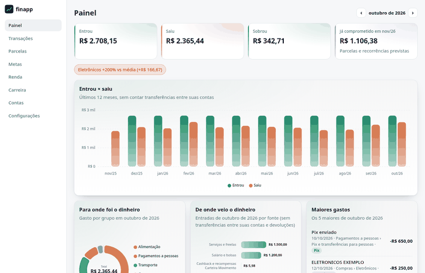
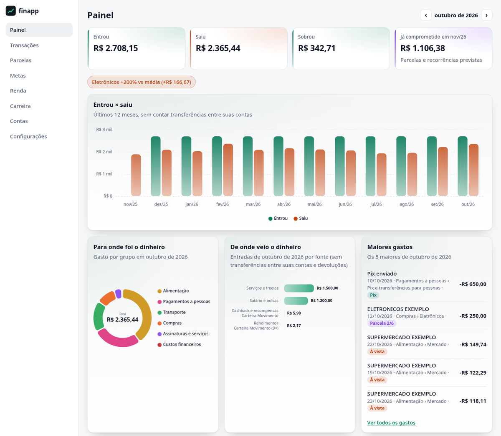
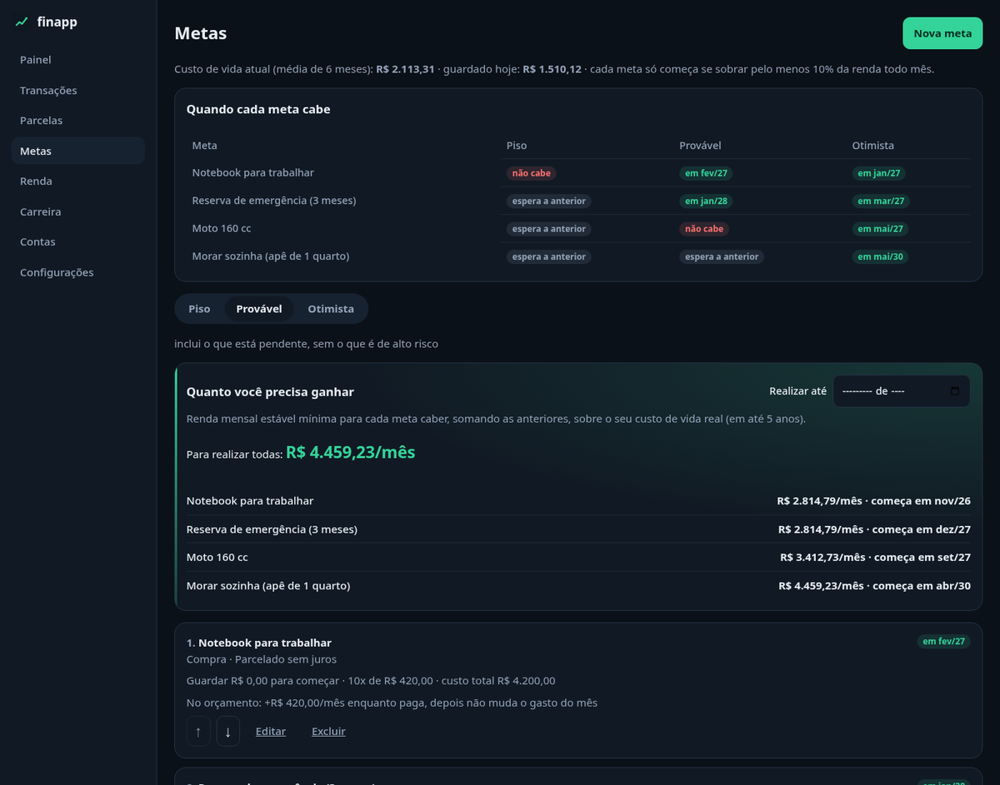
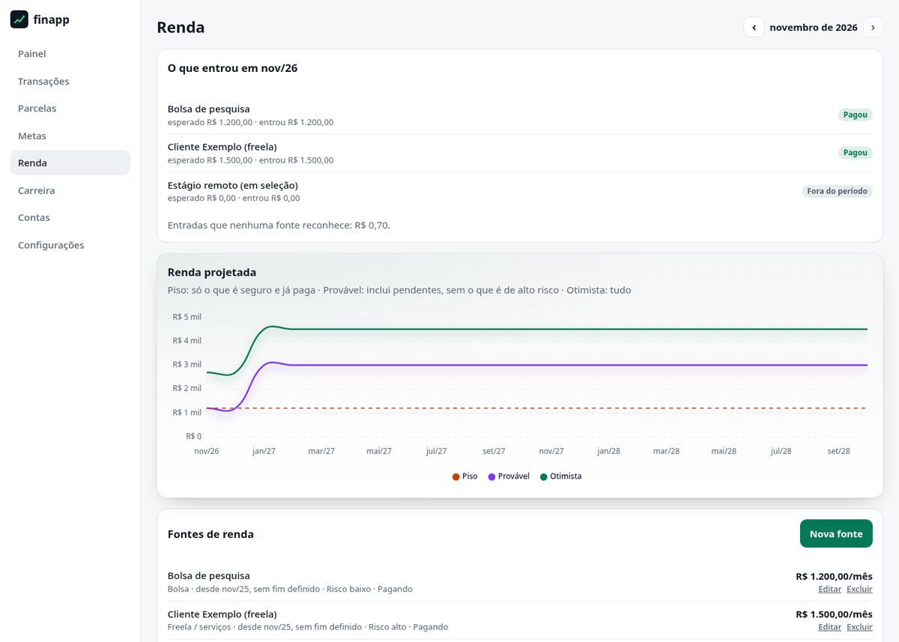
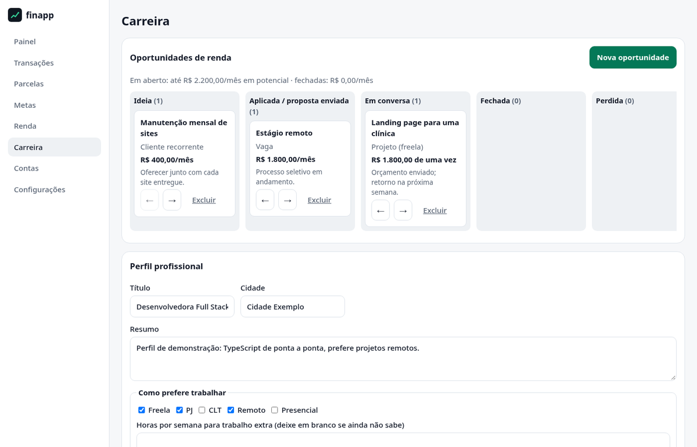
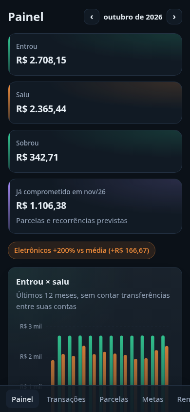
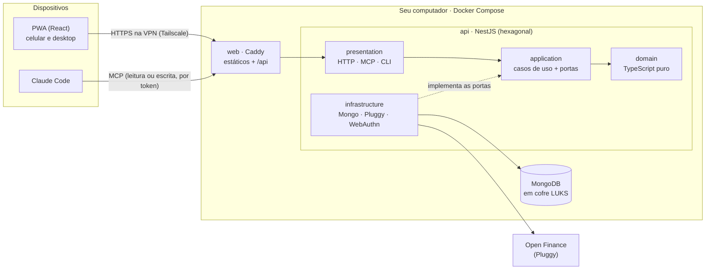

# finapp

[](https://github.com/BrunoNC22/finapp/actions/workflows/ci.yml)
[](LICENSE)

**Finanças pessoais self-hosted, com Open Finance e um assistente de IA.** O finapp junta suas contas e cartões, mostra
para onde o dinheiro vai e diz quanto você precisa ganhar (ou cortar) para chegar nas suas metas.



## Experimente em poucos minutos

Só precisa de **Docker**. Não precisa de conta em lugar nenhum.

```sh
git clone https://github.com/BrunoNC22/finapp.git && cd finapp
corepack pnpm demo        # constrói e sobe tudo (a primeira vez leva alguns minutos)
```

Sem Node.js (ou num Node sem `corepack`), o mesmo comando direto no Docker:
`docker compose -f compose.demo.yaml up -d --build --wait`.

Abra **http://localhost:8090** e toque em **Entrar na demonstração**. É uma pessoa fictícia, com 12 meses de
movimentação gerados na hora, metas, fontes de renda e um quadro de oportunidades. O banco vive em memória:

```sh
corepack pnpm demo:down   # ou: docker compose -f compose.demo.yaml down --volumes
```

## O que ele faz

- **Junta as contas via Open Finance** ([Meu Pluggy](https://meu.pluggy.ai)) e sincroniza sozinho a cada 6 horas.
- **Não conta o mesmo dinheiro duas vezes**: reconhece transferências entre as suas próprias contas, pagamento de
  fatura e devoluções (uma corrida cancelada reduz o gasto com transporte, não vira "renda").
- **Categoriza e aprende**: quando você corrige uma categoria, ele aprende pela contraparte e até pelo valor (o Pix de
  R$ 650 para a mesma pessoa é aluguel; o de R$ 90, a conta de luz).
- **Parcelas e recorrências**: o que já está comprometido nos próximos meses, assinaturas e contas que se repetem.
- **Metas com financiamento de verdade**: compra à vista, parcelada sem juros, financiada (Price) ou consórcio, além de
  metas de estilo de vida ("morar sozinho"). Cada uma é testada contra três cenários de renda (piso, provável e
  otimista), com o mês em que cabe e os caminhos quando não cabe.
- **Quanto você precisa ganhar**: a renda mensal mínima para todas as metas caberem, por busca binária sobre o plano.
- **Carreira**: perfil profissional e um quadro de oportunidades de renda (ideia → aplicada → em conversa → fechada).
- **Assistente de IA via MCP**: o Claude Code lê os dados, faz a análise do mês e, com um token de escrita, opera o
  app inteiro (categorias, regras, metas, renda, carreira), pelas mesmas regras da tela e com auditoria.
- **App de banco no celular**: PWA instalável, login por senha ou digital (passkey) e sessão que expira sozinha.

| Painel                                          | Metas (tema escuro)                                 |
| ----------------------------------------------- | --------------------------------------------------- |
|  |  |

| Renda e cenários                                  | Carreira                                                    | Celular                                                      |
| ------------------------------------------------- | ----------------------------------------------------------- | ------------------------------------------------------------ |
|  |  |  |

## Arquitetura



Módulos da API: `ledger` (contas, transações, categorias, parcelas), `planning` (renda e metas), `career`, `routine`,
`identity`, `assistant` (MCP) e `demo`. Detalhes em [docs/arquitetura.md](docs/arquitetura.md).

## Destaques de engenharia

- **Arquitetura hexagonal verificada no CI**: o domínio é TypeScript puro e os módulos só conversam pela camada de
  aplicação. As fronteiras são regras do dependency-cruiser que quebram o build
  ([ADR 0001](docs/adr/0001-arquitetura-hexagonal.md)).
- **TDD com dublês escritos à mão**: sem mocks mágicos. Cada repositório tem um **teste de contrato** que roda contra a
  versão em memória e contra o MongoDB real (Testcontainers), garantindo que os dublês não mentem
  ([ADR 0006](docs/adr/0006-vitest-e-dubles-de-teste-manuais.md)). São mais de 500 testes.
- **Dinheiro em centavos inteiros**, nunca `float` ([ADR 0002](docs/adr/0002-mongodb-e-dinheiro-em-centavos.md)).
- **Livro-caixa com regras explícitas**: sinal, classificação (gasto, entrada, entre contas, ignorada) e a precedência
  da categoria (manual > aprendida > devolução > regra > provedor) estão num ADR
  ([0011](docs/adr/0011-convencoes-do-livro-caixa.md)).
- **Open Finance atrás de uma porta**: o mesmo caso de uso sincroniza com a Pluggy ou com o provider de demonstração,
  que gera de propósito os casos difíceis (cadeias de transferência, fatura, parcelas iniciadas antes do histórico)
  ([ADR 0005](docs/adr/0005-open-finance-atras-de-uma-porta.md)).
- **Segurança em camadas**: dados em repouso num container LUKS, acesso só pela VPN, banco numa rede sem saída para a
  internet, login no estilo app de banco com passkey, CSP restrita e, no repositório, `gitleaks` mais uma denylist
  pessoal no pre-commit ([ADRs 0003, 0004, 0009 e 0012](docs/adr/README.md)).
- **IA com escrita controlada**: o servidor MCP roda na própria API, com tokens próprios de leitura ou de escrita. Cada
  módulo declara suas ferramentas, que chamam os mesmos controllers da tela; identidade fica de fora e toda escrita é
  auditada ([ADRs 0013 e 0014](docs/adr/0014-mcp-com-escrita-por-escopo.md)).
- **Gráficos com uma única configuração**: tema, cores fixas por categoria e formatação de moeda num só arquivo
  ([ADR 0007](docs/adr/0007-chartjs-com-configuracao-centralizada.md)).

| Camada | Tecnologias                                                       |
| ------ | ----------------------------------------------------------------- |
| API    | NestJS 12 (ESM) sobre Fastify · TypeScript 7 · Zod                |
| Banco  | MongoDB 8                                                         |
| Web    | React 19 · Vite · TanStack Query · Chart.js · PWA                 |
| IA     | Model Context Protocol (servidor HTTP) · Claude Code              |
| Testes | Vitest · Testing Library · Testcontainers · dublês escritos à mão |
| Infra  | Docker Compose · Caddy · Tailscale · LUKS · restic                |

## Sua própria instância

Para usar com as suas contas (cofre criptografado, Pluggy, acesso pelo celular via Tailscale e backup), siga
[docs/operacao.md](docs/operacao.md).

## Desenvolvimento

```sh
corepack enable
pnpm install          # também ativa os git hooks de segurança
pnpm check            # lint, fronteiras de arquitetura, tipos e testes
```

Contribuições são bem-vindas: veja [CONTRIBUTING.md](CONTRIBUTING.md).

## Licença

[MIT](LICENSE) · feito por [BrunoNC22](https://github.com/BrunoNC22)
